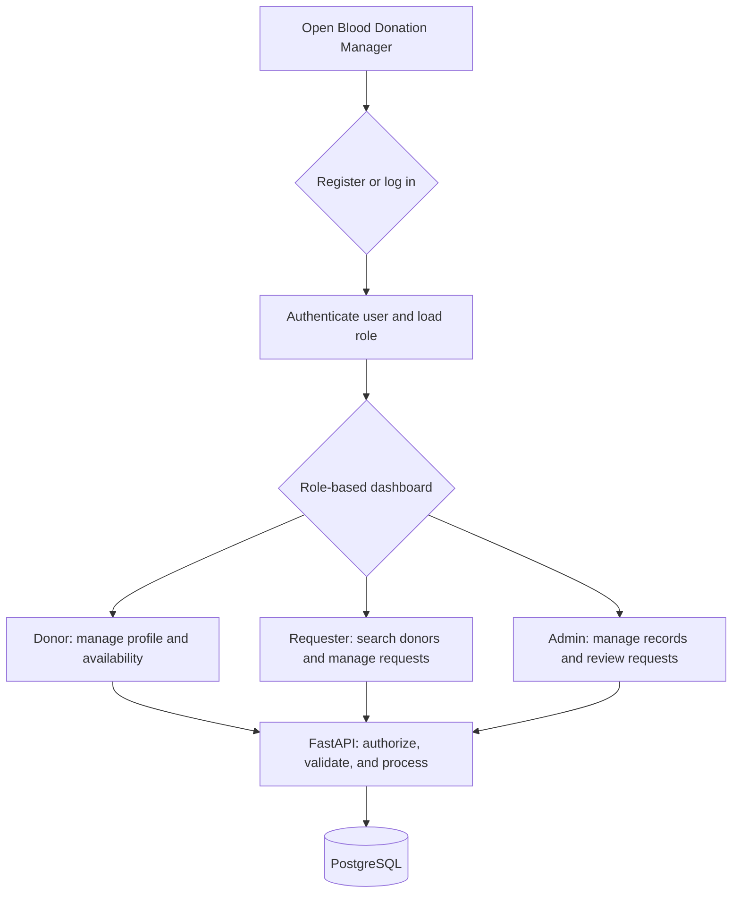
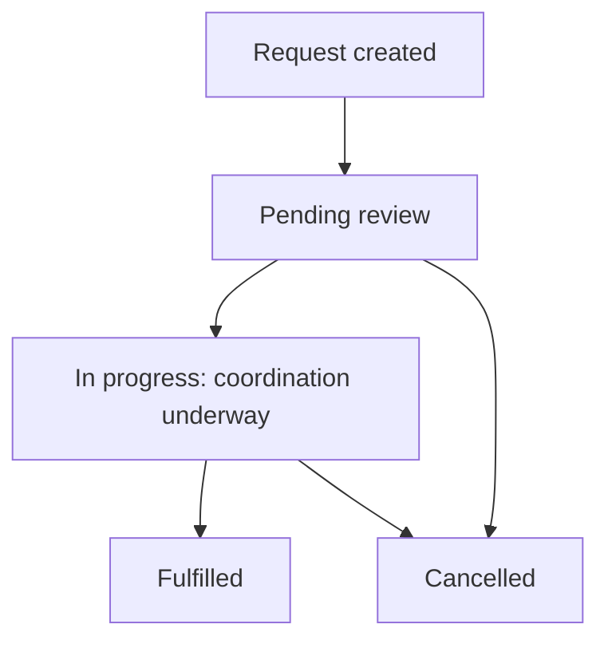

# Blood Donation Manager

**Day 22 project proposal and development plan**

**Planned development period:** Days 23–29
**Project type:** Full-stack web application

## Project at a glance

Blood Donation Manager is a web application for organizing donor profiles and blood requests in one place. Donors can maintain their profile and contact availability, requesters can submit and follow requests, and administrators can review records and coordinate the workflow.

| Area | Choice |
|---|---|
| Frontend | React and Tailwind CSS |
| Backend | Python and FastAPI |
| Database | PostgreSQL |
| ORM and validation | SQLAlchemy and Pydantic |
| Version control | Git and GitHub |

> **Important boundary:** This application supports coordination only. It does not provide medical advice, determine donor eligibility or blood compatibility, or guarantee that a donor can fulfill a request. Donor availability is self-reported and is not a clinical assessment.

## 1. Real-world problem research

Blood donation coordination can involve urgent requests and information spread across phone contacts, spreadsheets, messaging groups, and social media. These channels can make it difficult to find current information or know what has happened to a request.

The problem areas this project will address are:

- **Scattered donor information:** Records in multiple places are hard to search and keep current.
- **Time-consuming discovery:** Finding potential donors by blood group and location can require manually checking many records.
- **Unclear availability:** A donor's current willingness to be contacted may not be known.
- **Untracked requests:** A requester may not know whether a request is new, being coordinated, fulfilled, or cancelled.
- **Limited oversight:** Administrators may lack a consistent view of donor records and open requests.
- **Privacy risks:** Contact details should not be exposed to people who do not need them.

The proposed solution is a centralized, searchable system with role-based access, donor availability, request tracking, and a record of status changes. It will help organize coordination, not replace hospitals, blood banks, medical professionals, or clinical screening.

## 2. Why I selected this project

I selected Blood Donation Manager because it addresses a meaningful social need and provides a manageable opportunity to build a complete web application. Its core workflows are clear enough to prioritize for an MVP, while its technical requirements provide practical experience with:

- requirement analysis and feature prioritization;
- reusable React interfaces and responsive design;
- REST API development and backend validation;
- authentication, authorization, and privacy;
- relational database design and migrations;
- frontend/backend integration, testing, and documentation.

The project can be developed incrementally: first establish donor records and requests, then integrate the interfaces and test the complete workflows. Notifications and analytics can wait until the essential flows work reliably.

## 3. Target users

### Donors

People who want to register their donor details, manage their contact preferences, and update their self-reported availability.

### Blood requesters

People coordinating a blood need who want to submit a request, search authorized donor listings, and follow the request's status. A requester account associates each request with its owner.

### Administrators

Authorized staff who review donor records and requests, manage request statuses, and monitor the system dashboard.

Access to private information and actions will depend on the user's role and, where relevant, ownership of the record.

## 4. Problem statement

Donor details and blood requests are often maintained across disconnected communication channels and manual records. As a result, it can take time to identify potential donors by blood group and location, confirm whether they are willing to be contacted, and track a request through resolution.

**I propose to build Blood Donation Manager, a responsive web application that centralizes donor registration, self-reported availability, authorized donor search, blood request submission, and request status tracking.** The application will provide structured records and controlled access to personal information so users can coordinate more efficiently, while leaving medical eligibility and compatibility decisions to qualified professionals.

## 5. Project objectives

1. Maintain donor profiles and blood requests in a centralized database.
2. Let donors manage their profile and contact availability.
3. Let authorized users search donor records by blood group, city, and availability.
4. Provide a clear lifecycle for submitting and tracking blood requests.
5. Enforce authentication, role permissions, and record ownership in the backend.
6. Validate user input and preserve data relationships.
7. Deliver a responsive interface for desktop and mobile screens.
8. Test the main API and user workflows and document how to run the project.

## 6. MVP features and priorities

The first release will focus on the **P0** features below. **P1** items are future enhancements and are not required to complete the MVP.

| Priority | Feature | MVP behavior |
|---|---|---|
| P0 | Authentication | Register, log in, log out, and protect private pages and API routes. |
| P0 | Role-based access | Support donor, requester, and administrator permissions. |
| P0 | Donor registration | Save a donor's name, blood group, city, contact details, and contact consent. |
| P0 | Donor profile and availability | Let donors view and update their profile and self-reported availability. |
| P0 | Donor search | Filter authorized donor records by blood group, city, and availability. |
| P0 | Blood requests | Create, view, update permitted fields, and cancel requests according to permissions. |
| P0 | Request status tracking | Track pending, in-progress, fulfilled, and cancelled states. |
| P0 | Admin dashboard | Show summary counts for donors and requests. |
| P0 | Validation and responsive UI | Validate required inputs and provide usable mobile and desktop layouts. |
| P0 | API and workflow tests | Test valid, invalid, and unauthorized operations and key user journeys. |
| P1 | Notifications | Notify users about new requests and status changes. |
| P1 | Advanced location search | Search by distance or more precise geographic location. |
| P1 | Analytics and reports | Report on donor registrations and request outcomes. |
| P1 | Donation history | Record verified past donation events. |

## 7. User stories and acceptance criteria

| ID | User story | Acceptance criteria |
|---|---|---|
| US-01 | As a donor, I want to register my profile so that my donor information can be maintained. | Valid details are saved; invalid fields and duplicate account identifiers are rejected with clear messages. |
| US-02 | As a donor, I want to update my availability so that my profile reflects whether I am willing to be contacted. | My updated availability is saved and reflected in authorized search results. |
| US-03 | As a requester, I want to search by blood group and location so that I can find relevant donor records. | Results match the selected filters and do not reveal fields the requester is not authorized to see. |
| US-04 | As a requester, I want to create a blood request so that the need is recorded in one place. | A request with valid blood group, location, units, urgency, and required details is saved with an initial status. |
| US-05 | As a requester, I want to track my request so that I know its current status. | The requester can view their request and its current status; unrelated users cannot access private request details. |
| US-06 | As an administrator, I want to review blood requests so that they can be coordinated consistently. | Only an authorized administrator can perform administrative actions, and valid changes are saved. |
| US-07 | As an administrator, I want to manage donor records so that inaccurate records can be addressed. | Donor record changes are restricted to authorized administrators and relevant changes are traceable. |
| US-08 | As a user, I want to use the application on a mobile device so that I can access its essential features on different screen sizes. | Forms, navigation, and record lists remain usable on supported mobile and desktop layouts. |
| US-09 | As a user, I want clear validation messages so that I can correct mistakes when submitting information. | Invalid input is rejected with a message that identifies what needs correction. |
| US-10 | As an administrator, I want to view summary statistics so that I can monitor registrations and requests. | Dashboard totals are derived from stored records and follow documented status definitions. |

A story is complete when its behavior, validation, authorization, relevant tests, and documentation are in place.

## 8. Application flow

### General application flow



The frontend sends requests to FastAPI. The backend checks authentication, permissions, input validity, and business rules before reading or changing PostgreSQL records.

### Blood request lifecycle



A request is only marked **Fulfilled** when the request is actually resolved; identifying or contacting a potential donor alone does not fulfill it.

## 9. Database design

PostgreSQL will be the system of record. SQLAlchemy will map application models to tables, and Pydantic schemas will validate API input and output. Foreign keys will enforce relationships, and indexes will support common searches.

### Tables

#### `users`

| Column | Type | Constraints / purpose |
|---|---|---|
| `id` | Integer | Primary key |
| `full_name` | String | Account holder's name |
| `email` | String | Unique login identifier |
| `password_hash` | String | Secure password hash; never store a plain-text password |
| `role` | Enum | `donor`, `requester`, or `admin` |
| `is_active` | Boolean | Whether the account can access the application |
| `created_at` | Timestamp | Account creation time |

#### `donors`

| Column | Type | Constraints / purpose |
|---|---|---|
| `id` | Integer | Primary key |
| `user_id` | Integer | Foreign key to `users.id`; unique for one donor profile per account |
| `blood_group` | Enum | ABO/Rh group |
| `phone` | String | Contact number; protected personal information |
| `city` | String | City or locality used in search |
| `availability_status` | Enum | `available`, `unavailable`, or `unknown` |
| `consent_to_contact` | Boolean | Contact preference |
| `updated_at` | Timestamp | Last profile update |

#### `blood_requests`

| Column | Type | Constraints / purpose |
|---|---|---|
| `id` | Integer | Primary key |
| `requester_id` | Integer | Foreign key to `users.id` |
| `blood_group` | Enum | Requested blood group |
| `units_required` | Integer | Must be a positive value |
| `hospital_name` | String | Hospital or medical facility |
| `city` | String | Request location |
| `urgency` | Enum | `routine`, `urgent`, or `emergency` |
| `required_by` | Timestamp | Requested time or deadline |
| `status` | Enum | `pending`, `in_progress`, `fulfilled`, or `cancelled` |
| `created_at` | Timestamp | Request creation time |

#### `donation_coordination`

| Column | Type | Constraints / purpose |
|---|---|---|
| `id` | Integer | Primary key |
| `request_id` | Integer | Foreign key to `blood_requests.id` |
| `donor_id` | Integer | Foreign key to `donors.id` |
| `coordination_status` | Enum | `contact_pending`, `contacted`, `declined`, or `completed` |
| `created_at` | Timestamp | Coordination record creation time |

Each coordination row connects one potential donor with one request. Coordination is not proof of eligibility or successful donation.

#### `request_status_history`

| Column | Type | Constraints / purpose |
|---|---|---|
| `id` | Integer | Primary key |
| `request_id` | Integer | Foreign key to `blood_requests.id` |
| `changed_by` | Integer | Foreign key to `users.id` |
| `previous_status` | String / enum | Status before the change |
| `new_status` | String / enum | Status after the change |
| `note` | Text | Optional reason or update |
| `created_at` | Timestamp | Change timestamp |

This table provides a traceable history of request status changes.

### Entity relationships

```mermaid
erDiagram
    USERS ||--o| DONORS : has
    USERS ||--o{ BLOOD_REQUESTS : creates
    BLOOD_REQUESTS ||--o{ DONATION_COORDINATION : includes
    DONORS ||--o{ DONATION_COORDINATION : participates
    BLOOD_REQUESTS ||--o{ REQUEST_STATUS_HISTORY : records
    USERS ||--o{ REQUEST_STATUS_HISTORY : changes

    USERS {
        int id PK
        string full_name
        string email UK
        string password_hash
        string role
    }
    DONORS {
        int id PK
        int user_id FK
        string blood_group
        string phone
        string city
        string availability_status
        boolean consent_to_contact
    }
    BLOOD_REQUESTS {
        int id PK
        int requester_id FK
        string blood_group
        int units_required
        string city
        string urgency
        string status
    }
    DONATION_COORDINATION {
        int id PK
        int request_id FK
        int donor_id FK
        string coordination_status
    }
    REQUEST_STATUS_HISTORY {
        int id PK
        int request_id FK
        int changed_by FK
        string previous_status
        string new_status
    }
```



## 10. Technical architecture and API outline

### Frontend — React and Tailwind CSS

Provides forms, donor search, role-specific dashboards, request details, and status updates. Reusable UI components and a shared API client keep the interface consistent.

### Backend — Python and FastAPI

Provides REST endpoints and business logic for authentication, donor profiles, donor search, requests, coordination, and dashboard summaries. Pydantic validates data; SQLAlchemy handles persistence. Authorization is checked on the server, not only in the UI.

### Database — PostgreSQL

Stores accounts, donor profiles, requests, coordination records, and status history, with foreign keys, constraints, and indexes to preserve integrity and support searches.

### Proposed REST endpoints

All endpoints use the `/api/v1` prefix.

| Method | Endpoint | Purpose |
|---|---|---|
| `POST` | `/auth/register` | Register an account |
| `POST` | `/auth/login` | Authenticate a user |
| `GET` | `/auth/me` | Get the current user's profile |
| `GET` | `/donors` | Search authorized donor records |
| `POST` | `/donors` | Create a donor profile |
| `GET` | `/donors/{id}` | Get an authorized donor profile |
| `PATCH` | `/donors/{id}` | Update a permitted donor profile |
| `POST` | `/requests` | Create a blood request |
| `GET` | `/requests` | List requests accessible to the user |
| `GET` | `/requests/{id}` | View an authorized request |
| `PATCH` | `/requests/{id}` | Update permitted request fields or status |
| `POST` | `/requests/{id}/coordination` | Record a donor coordination attempt |
| `GET` | `/admin/dashboard` | Get administrator statistics |

The API will use consistent validation errors and HTTP status codes. List endpoints should support pagination where appropriate.

## 11. Project folder structure

```text
blood-donation-manager/
├── frontend/
│   ├── public/
│   └── src/
│       ├── components/
│       │   ├── Navbar.jsx
│       │   ├── DonorCard.jsx
│       │   ├── RequestCard.jsx
│       │   └── StatusBadge.jsx
│       ├── pages/
│       │   ├── Login.jsx
│       │   ├── Register.jsx
│       │   ├── Dashboard.jsx
│       │   ├── DonorSearch.jsx
│       │   ├── DonorProfile.jsx
│       │   └── BloodRequests.jsx
│       ├── layouts/
│       ├── services/
│       │   └── api.js
│       ├── hooks/
│       ├── context/
│       ├── utils/
│       ├── App.jsx
│       └── main.jsx
├── backend/
│   ├── app/
│   │   ├── main.py
│   │   ├── api/routes/
│   │   ├── core/
│   │   │   ├── config.py
│   │   │   └── security.py
│   │   ├── db/
│   │   ├── models/
│   │   ├── schemas/
│   │   ├── services/
│   │   └── dependencies/
│   ├── tests/
│   ├── alembic/
│   └── requirements.txt
├── docs/
│   ├── proposal.md
│   ├── problem-statement.md
│   ├── user-stories.md
│   ├── database-design.md
│   ├── application-flow.md
│   └── development-plan.md
├── .env.example
├── .gitignore
└── README.md
```

Business logic will be kept out of route handlers where practical. Backend tests, reusable frontend components, and separate model/schema/service layers will make the project easier to maintain.

## 12. GitHub repository setup

**Planned repository name:** `blood-donation-manager`

**Description:** A full-stack blood donation coordination platform built with React, FastAPI, and PostgreSQL to manage donor profiles, blood requests, availability, and request tracking.


## 13. Development plan — Days 23–29 (1 week)

| Day | Focus | Planned work | Deliverable |
|---|---|---|---|
| **23** | Research and planning | Finalize the problem, users, scope, MVP, stories, app flow, schema, folder structure, and GitHub repository. | Project proposal, requirements, diagrams, schema, and repository. |
| **24** | Backend and database setup | Configure Python, FastAPI, SQLAlchemy, PostgreSQL, database sessions, initial models, relationships, and Alembic migrations. | Working backend foundation and initial database tables. |
| **25** | Authentication and donor management | Implement registration, login, password hashing, role checks, donor profile creation/updates, availability, validation, and access tests. | Authentication workflow and donor profile APIs. |
| **26** | Requests and donor search | Implement request creation and permitted updates/cancellation, donor filters, coordination records, and status history; test validation and permissions. | Donor search and blood request APIs. |
| **27** | React UI | Build login/registration, dashboard, donor form, donor search, and request screens with reusable responsive components. | Responsive frontend with the primary screens. |
| **28** | Integration and testing | Connect React to FastAPI, configure CORS, integrate authentication, and test complete donor and request workflows with loading/error states. | Integrated application with core workflows tested. |
| **29** | Final review and release preparation | Run tests, fix critical bugs, review privacy/security, finish setup/API documentation, add screenshots, and prepare deployment. | Tested and documented MVP ready for deployment. |

If time is limited, the donor and request workflows, validation, and access control take priority. Notifications, advanced location features, and analytics remain outside the initial release.

## 14. DSA and coding practice

| Area | Practice task | How it applies |
|---|---|---|
| Python and OOP | Design `User`, `Donor`, and `BloodRequest` classes. | Model the main entities and their behavior. |
| Python and DSA | Filter donors by blood group, city, and availability. | Understand the donor search logic. |
| Python and DSA | Count blood requests by status using a dictionary. | Calculate dashboard summaries. |
| SQL | Join donors, users, and coordination records. | Retrieve related records. |
| React | Build reusable `DonorCard`, `RequestForm`, and `StatusBadge` components. | Keep the interface consistent. |
| API development | Add pagination, filtering, and validation. | Improve API usability and reliability. |

Example learning exercise (production search should use authorized database queries):

```python
def filter_donors(donors, blood_group, city):
    return [
        donor
        for donor in donors
        if donor["blood_group"] == blood_group
        and donor["city"].casefold() == city.casefold()
        and donor["availability_status"] == "available"
    ]
```

## 15. Testing strategy

- **Unit tests:** Validate business rules, input constraints, and request status transitions.
- **API tests:** Cover registration, login, donor search, request creation/updates, and permission checks.
- **Integration tests:** Verify that API operations persist and retrieve data correctly from PostgreSQL.
- **Frontend tests:** Check forms, validation messages, navigation, search filters, and loading/error states.
- **End-to-end tests:** Exercise donor registration, donor search, request creation, and status tracking.
- **Edge cases:** Test duplicate emails, unsupported blood groups, missing fields, non-positive units, invalid status changes, unauthorized access, and cross-user record access.

## 16. Security and privacy

- Hash passwords with an established password-hashing algorithm; never store plain-text passwords.
- Require authentication for private pages and API endpoints.
- Enforce role permissions and record ownership in backend code.
- Validate all fields, permitted blood groups, units, and status transitions.
- Restrict access to donor contact details and honor contact consent.
- Keep secrets in environment variables and exclude private environment files from Git.
- Record important request status changes for traceability.
- Use synthetic test data in development, documentation, and screenshots.
- Treat availability as self-reported, not medical eligibility; do not claim compatibility or guarantee fulfillment.

## 17. Deployment plan

1. Configure production environment variables and database credentials.
2. Apply database migrations to the production database.
3. Build the React frontend for production.
4. Deploy the FastAPI backend and configure its database connection.
5. Configure HTTPS, CORS, authentication settings, and allowed frontend origins.
6. Verify the deployed application using the main user workflows.
7. Document deployment steps and known limitations.

Deployment is complete only after the deployed application has been tested. If deployment is outside the available time, provide verified local setup instructions and a deployment checklist instead.


## 18. Expected outcome

The expected outcome is a functional, responsive Blood Donation Manager MVP that centralizes donor profiles and blood requests. Its core workflows will support donor registration, authorized donor search, self-reported availability updates, request management, role-based access, and status tracking.

The project will demonstrate requirement analysis, software architecture, relational database design, REST API development, frontend/backend integration, testing, Git version control, and technical documentation. It will provide a maintainable foundation that can be extended with notifications, advanced location search, and reporting after the core workflows are stable.